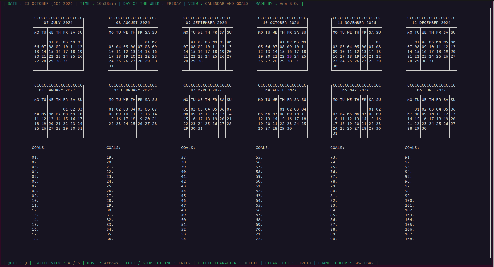
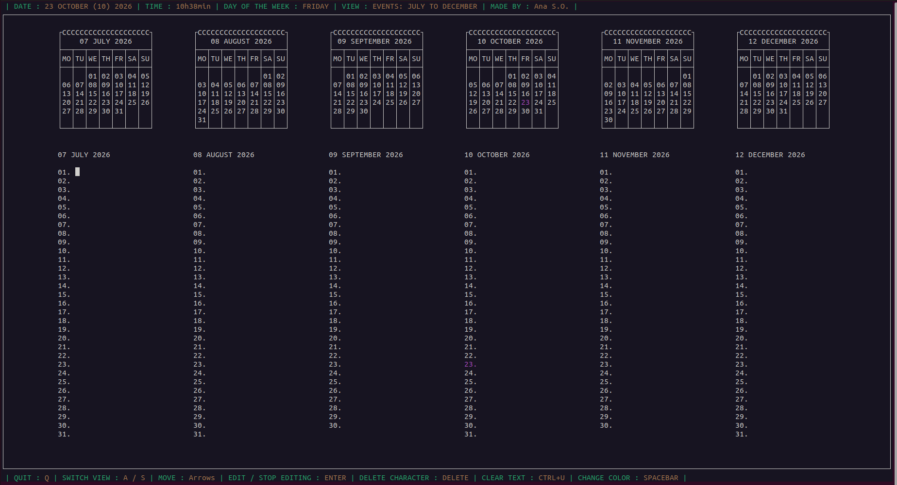
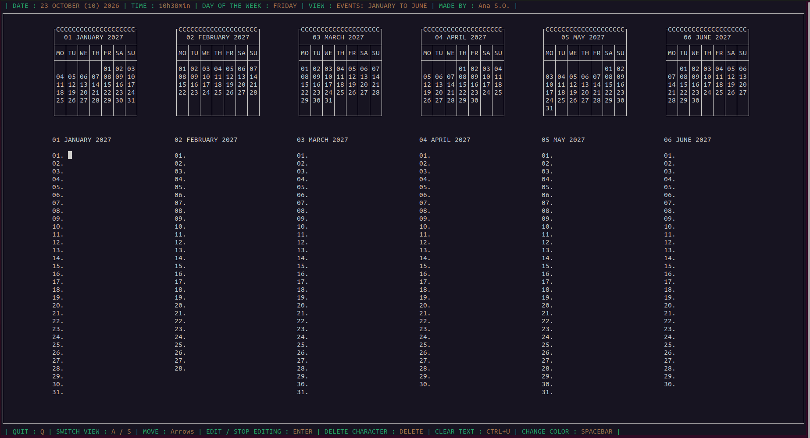
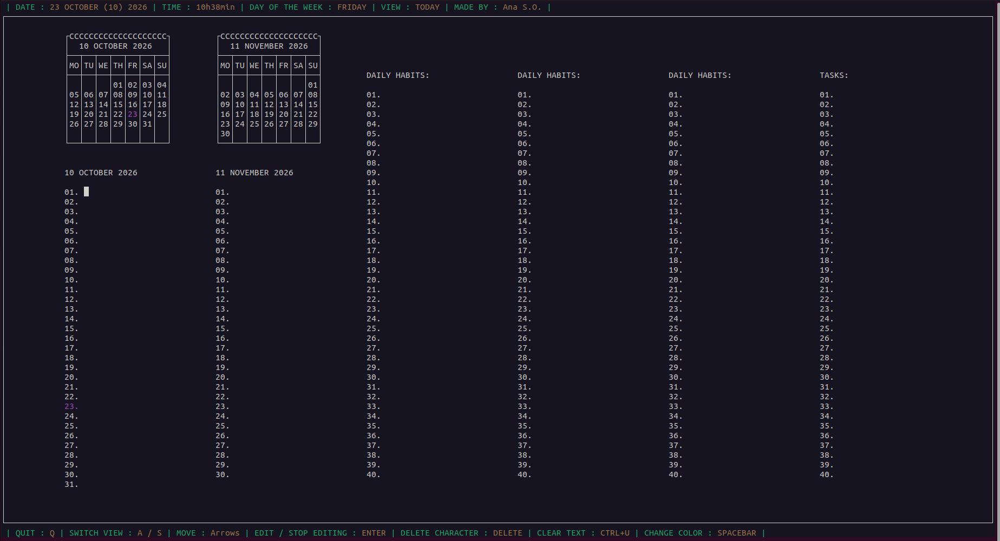

# planner

Um planner de terminal em C/ncurses: calendário do ano letivo, objetivos,
hábitos diários, tarefas e notas por dia, tudo editável sem sair do
terminal.

Comecei este projeto no verão de 2023, e esta é a versão mais recente :)

## Instalar

Precisa do ncurses (com suporte a largura de carateres/UTF-8):

	sudo apt-get install libncurses-dev

## Compilar e correr

	make
	./planner

A janela do terminal precisa de pelo menos 53 linhas x 203 colunas (o
programa diz-te o tamanho exato se não couber, e sai sem corromper nada --
é só aumentar a janela e correr `./planner` outra vez).

	make clean    # remove o executável e os ficheiros .o

## Vistas

| Vista | O que tem |
|---|---|
| `CALENDAR AND GOALS` | calendário do ano letivo (Julho a Junho) + 108 objetivos |
| `EVENTS: JULY TO DECEMBER` | uma nota por cada dia, de Julho a Dezembro |
| `EVENTS: JANUARY TO JUNE` | uma nota por cada dia, de Janeiro a Junho |
| `TODAY` | mês atual e seguinte, hábitos diários (3 colunas, 40 cada) e tarefas |

Screenshots das 4 vistas

**CALENDAR AND GOALS**

**EVENTS: JULY TO DECEMBER**

**EVENTS: JANUARY TO JUNE**

**TODAY**

## Comandos

	Setas              mover
	A / S              trocar de vista
	ENTER              editar / parar de editar o item selecionado
	Setas (a editar)   mover o cursor dentro do texto
	Home / End         ir para o início / fim do texto
	Delete             apagar o carácter à frente do cursor
	Ctrl+U             limpar o texto todo
	SPACEBAR           mudar a cor do item selecionado
	Q                  sair

Objetivos, hábitos e tarefas só alternam entre vermelho (por fazer) e
verde (feito) -- os eventos e as notas percorrem as 6 cores disponíveis
(sem cor, vermelho, verde, amarelo, ciano, azul).

## Dados

Tudo fica em `~/.config/planner/`, um ficheiro de texto simples por
categoria (`<cor><TAB><texto>` por linha) -- fácil de abrir, inspecionar
ou editar à mão. Os hábitos diários reiniciam para vermelho a cada dia
novo; o resto fica como o deixaste.

## Stars

